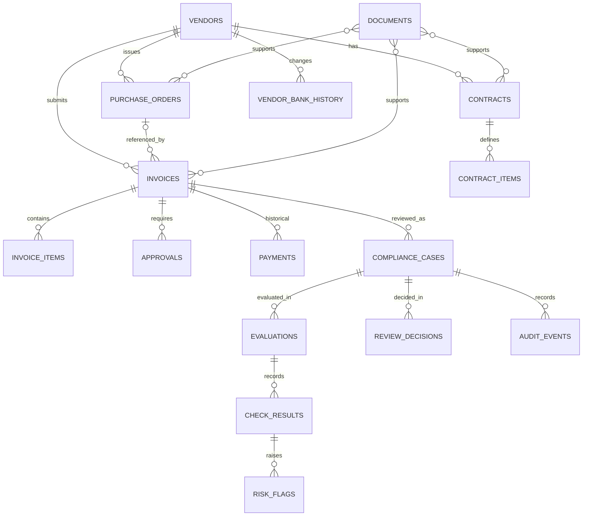

# NAXA — Draft Database Design

**Status:** Initial technical draft for product-owner review. This is a starting schema, not a migration or final implementation contract.
**Sources:** [PRD](prd.md), [constitution](constitution.md), [technical architecture](technical-architecture.md), and the [feature specifications](specifications/README.md).

## Design rules

- PostgreSQL is the system of record for normalized business data, playbook results, evaluations, decisions, and audit events.
- Use UUID primary keys and foreign keys for internal relationships. Keep human-facing identifiers such as invoice numbers and PO numbers as separate fields.
- Store monetary values in `NUMERIC`, never floating point. The precision/scale policy and rounding rules must be finalized in the technical specification.
- Store timestamps in `TIMESTAMPTZ`; evaluate time-based rules against a recorded evaluation time.
- Do not make `(vendor_id, invoice_number)` unique; duplicate submissions must remain available for comparison.
- Keep uploaded file contents in private file storage. Use a private Docker volume during local development and a private cloud object-storage service after deployment; store metadata and an opaque storage key in PostgreSQL. AWS S3 is a candidate for the later AWS phase, but the provider remains open.
- Keep past document versions and evaluations; mark the current document version without overwriting prior evidence.
- Represent absent, unavailable, unverified, and not-applicable evidence distinctly.

## Initial entity map



The diagram shows the intended MVP relationships. Exact cardinalities and whether approval requirements need their own policy tables remain to be finalized. One invoice references at most one PO in the first version; a PO can be referenced by multiple invoices. Multiple-PO invoices require manual review.

## First-slice relationship in plain terms

```text
Vendor
  ├── Purchase Orders
  └── Invoices ── optional link to one Purchase Order
          ├── Uploaded documents (invoice and evidence)
          └── Compliance Case ── Evaluations ── Check Results
```

The invoice's PO number is used to find a PO for the same vendor. PostgreSQL stores the relationship by internal IDs after matching. A missing or ambiguous link stays unresolved and produces an UNVERIFIED check; the database must not invent a link.

## Proposed first-slice columns

These are a draft for review, not a migration script. `UUID` IDs are internal identifiers. `NUMERIC` amounts avoid floating-point money errors. The MVP currency codes are USD, GBP, and PKR; currency conversion is out of scope. Document totals use two decimal places for these currencies. Add a check constraint so stored currency codes use only the supported values. Unit-price precision and rounding rules need final specification.

### `vendors`

| Column | Type | Purpose |
| --- | --- | --- |
| `id` | UUID primary key | Internal vendor ID. |
| `vendor_code` | Text, nullable | Vendor identifier from the user's records. |
| `name` | Text | Display name. |
| `created_at` | `TIMESTAMPTZ` | Record creation time. |

Potential constraint: unique `(vendor_code)` only if the source identifier is known to be stable and unique; otherwise retain duplicates for user resolution.

### `purchase_orders`

| Column | Type | Purpose |
| --- | --- | --- |
| `id` | UUID primary key | Internal PO ID. |
| `vendor_id` | UUID foreign key to `vendors.id` | PO's vendor. |
| `po_number` | Text | Human-facing PO number. |
| `document_total` | `NUMERIC(18,2)`, nullable until confirmed | Total read from the PO document. |
| `currency` | `CHAR(3)`, nullable until confirmed | PO currency code: USD, GBP, or PKR. |
| `source_document_id` | UUID foreign key to `documents.id`, nullable | PO source file, when uploaded. |
| `created_at` | `TIMESTAMPTZ` | Record creation time. |

Proposed uniqueness: `(vendor_id, po_number)`. This permits two vendors to use the same PO number while preventing duplicate PO records for one vendor. Ambiguous imports must be resolved before applying this constraint.

### `invoices`

| Column | Type | Purpose |
| --- | --- | --- |
| `id` | UUID primary key | Internal invoice ID. |
| `vendor_id` | UUID foreign key to `vendors.id` | Invoice's vendor. |
| `purchase_order_id` | UUID foreign key to `purchase_orders.id`, nullable | Resolved link to one PO. Nullable so missing PO can be reviewed. |
| `invoice_number` | Text | Human-facing invoice number. Do not make unique; duplicates must be detectable. |
| `invoice_date` | `DATE`, nullable until confirmed | Date on the invoice. |
| `document_total` | `NUMERIC(18,2)`, nullable until confirmed | Invoice total read from the document. |
| `currency` | `CHAR(3)`, nullable until confirmed | Invoice currency code: USD, GBP, or PKR. |
| `created_at` | `TIMESTAMPTZ` | Record creation time. |

The resolved PO's vendor must equal the invoice's vendor. Store the PO foreign key only after the user/system has resolved the PO number and confirmed the vendor match. For this first version, one invoice links to zero or one PO; multiple-PO invoices are sent to human review.

### `documents` and `document_links`

`documents` stores upload metadata (`id`, opaque `storage_key`, safe original filename, media type, byte size, checksum, upload time, extraction/verification status, and version). The actual file is stored privately outside PostgreSQL. During local development, the storage key points into a Docker volume; after deployment, it points to an object in the configured private bucket. The backend accesses files; the UI does not receive a public storage path.

`document_links` connects a document to its invoice, PO, contract, or other evidence record (`document_id`, record type/ID, evidence role, current-version flag). Keep old versions linked for audit history; mark the replacement current instead of overwriting the old file. The exact polymorphic-link approach is a technical choice to review before implementation.

### `compliance_cases`, `evaluations`, and `check_results`

- `compliance_cases`: `id`, unique `invoice_id`, review status, created/updated times. Clarification requests leave the case open and on hold.
- `evaluations`: `id`, `case_id`, playbook/policy version IDs, evaluation time, nullable score and risk level, completeness status. The first comparison is unscored, so `score` and `risk_level` are null rather than zero/LOW.
- `check_results`: `id`, `evaluation_id`, rule code (for example `PO_COMPARISON`), result status (`COMPLETE`, `UNVERIFIED`, or `NOT_APPLICABLE`), expected/actual values, difference, explanation, and source references. Missing or mismatched currency yields `UNVERIFIED` with no fabricated difference.

When the full scoring feature is added, known risk findings and their score can be shown alongside UNVERIFIED for other missing checks. Each evaluation preserves its original input/source references so a later upload does not rewrite the prior result.

### `playbook_versions` and `playbook_requirements`

The playbook is the checklist of evidence required for a review. Seed a built-in first-slice version that requires an invoice and linked PO and treats contract as optional; users do not upload a separate playbook workbook. `playbook_versions` stores the checklist version used by an evaluation. `playbook_requirements` stores one checklist item per row. Custom playbook setup and management remain out of the first slice.

### Example checklist result

For one invoice evaluation, `check_results` records the result of applying the relevant playbook requirements:

| Check | Result | Meaning |
| --- | --- | --- |
| Invoice document | `COMPLETE` | Required invoice evidence was uploaded and confirmed. |
| Linked PO | `UNVERIFIED` | No PO was found or the PO match is unresolved; request the document or user clarification. |
| Contract price | `NOT_APPLICABLE` | The user confirmed that no contract applies to this invoice. |

The playbook defines what is expected; check results record what happened for this particular invoice. Missing evidence is not recorded as a passing check.

### `review_decisions` and `audit_events`

Store every reviewer action as a separate `review_decisions` row with the case ID, action (`APPROVE`, `REJECT`, or `REQUEST_CLARIFICATION`), required reason, reviewer identifier, and timestamp. Do not overwrite a previous decision. A clarification request leaves the case open and on hold; after new evidence arrives, a later evaluation and later decision can be added to the same case.

`audit_events` records important activity such as document uploaded/replaced, fields confirmed, PO link resolved, evaluation completed, and review decision recorded. Each event includes the affected case/entity, event type, actor or system identifier, timestamp, and details needed to understand the change. Store references to earlier document versions and evaluations so their history remains traceable.

## Tables and purpose

| Table | Main fields and purpose |
| --- | --- |
| `vendors` | `id`, `vendor_code`, `name`; vendor identity used to validate invoice/PO links. |
| `purchase_orders` | `id`, `vendor_id`, `po_number`, `document_total`, `currency`, source dates/status; unique PO number per vendor. |
| `invoices` | `id`, `vendor_id`, optional `purchase_order_id`, `invoice_number`, `invoice_date`, `document_total`, `currency`; intentionally allows duplicate invoice numbers. |
| `invoice_items` | `id`, `invoice_id`, `item_code`, description, quantity, unit, `unit_price`, currency; supports later line-level contract checking. |
| `contracts` | `id`, `vendor_id`, optional contract number, validity period, status; optional per invoice. |
| `contract_items` | `id`, `contract_id`, `item_code`, description, unit, `unit_price`, currency; used for agreed-price comparisons. |
| `approvals` | `id`, `invoice_id`, approval type/status, reviewer reference, timestamps, evidence reference; checked against playbook requirements. |
| `payments` | `id`, `invoice_id`, amount, currency, payment date/reference/status; historical evidence only, never initiates payment. |
| `vendor_bank_history` | `id`, `vendor_id`, masked identifier/fingerprint, changed timestamp, verification status and evidence reference. Do not store or expose full account identifiers unless a justified requirement is approved. |
| `documents` | `id`, opaque private `storage_key`, original filename metadata, media type, size, checksum, version, current flag, upload timestamp, source/extraction status. Store bytes outside PostgreSQL. |
| `document_links` | `document_id`, entity type/id, evidence role; links one document to invoices, POs, contracts, or other supporting records. |
| `playbook_versions` | `id`, name, version, status, created timestamp; preserves the requirements used by an evaluation. |
| `playbook_requirements` | `id`, `playbook_version_id`, requirement code, description, applicable evidence type, required/optional flag. |
| `compliance_cases` | `id`, `invoice_id`, review status, created/updated timestamps; case can retain multiple evaluations. |
| `evaluations` | `id`, `case_id`, policy/playbook versions, evaluated timestamp, total score if calculated, risk band, completeness status. First-slice evaluation has no score. |
| `check_results` | `id`, `evaluation_id`, rule code, result status, explanation, source snapshot/reference; distinguishes clear, finding, unverified, and not-applicable checks. |
| `risk_flags` | `id`, `check_result_id`, risk type/severity, expected and actual values, difference, contributing weight when scoring is enabled. |
| `review_decisions` | `id`, `case_id`, action, reason, reviewer identifier, timestamp; append-only decision history. |
| `audit_events` | `id`, case/entity reference, event type, actor/system identifier, details, timestamp; application-level append-only activity log. |

## First-slice data example

An invoice row stores the invoice document total and currency, its vendor, and its matched PO relationship. A PO row stores the PO document total and currency. The evaluation records the two source references and `invoice_total - po_total`. The result is informational and unscored in the first slice. If the PO link is missing/ambiguous or currencies differ, record UNVERIFIED instead of inventing a difference.

## Constraints to carry into detailed design

- Invoice-to-PO linking uses the PO number and verifies the vendor matches. The user resolves missing or ambiguous matches; do not guess.
- Multiple invoices may reference the same PO. First-slice comparison uses the full PO document total; prior invoices are context only and are not subtracted.
- Contracts are optional. If provided/referenced, compare item unit prices using item codes when available; otherwise ask the user to confirm the item match.
- A recent unverified vendor bank change uses the agreed 30-day window, forces HIGH in full scoring, and requires human review.
- An unverified known evaluation may retain known findings/score alongside UNVERIFIED; it cannot recommend clearance.
- Requesting clarification leaves the case open and on hold. Replacing a document retains earlier versions and evaluation references.

## Open decisions

- Monetary rounding rules and contract unit-price precision.
- Playbook ownership, exact requirement rows, and applicability rules.
- Supported upload formats, parser, storage implementation, file limits, retention, and checksum policy.
- Review status names/transitions and exact referential/cascade-delete policy.
- Approval requirement entities and how individual approval records are represented.
- Exact treatment of rejected, pending, and unverifiable approvals in scoring.
