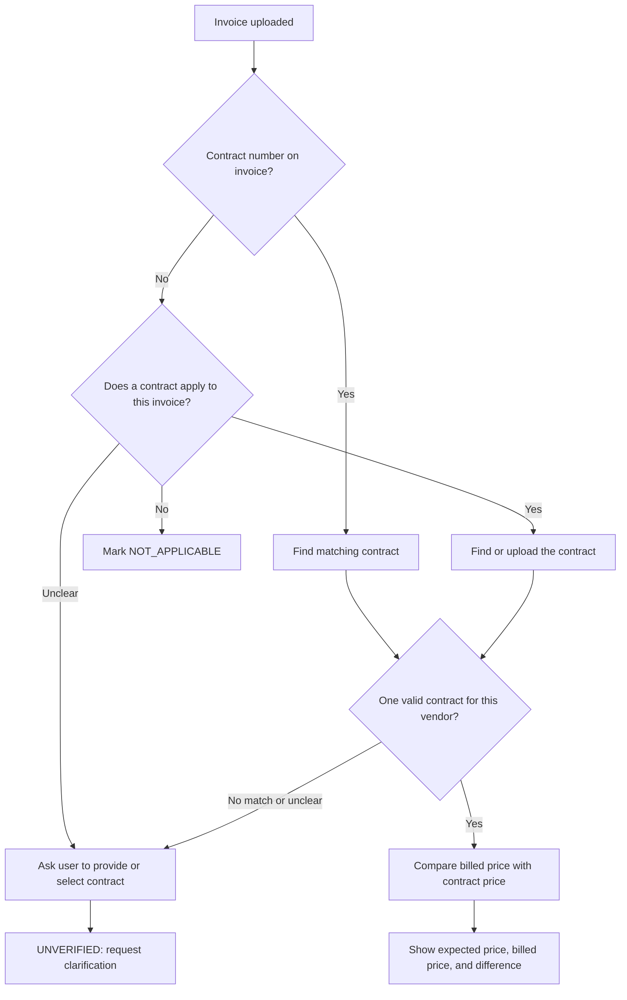

# Contract-Price Comparison

**Status:** Draft for product-owner review; unresolved business rules are listed below.
**Authority:** [PRD v1.1](../prd.md), [constitution](../constitution.md), and [draft technical architecture](../technical-architecture.md).

## Purpose and scope

Compare billed prices/rates with the applicable contract. Implements FR-03; supports AC-03.

A contract is the vendor agreement that sets terms such as agreed prices and when those terms apply. Naxa uses the uploaded contract as evidence to compare against invoice prices. A PO describes a specific purchase; the contract describes the agreed terms for purchases from that vendor.

Contracts are optional in the MVP; Naxa does not require one for every invoice. When a contract is supplied or referenced for an invoice, Naxa checks it against the billed prices. When the user indicates that no contract applies, mark the check NOT_APPLICABLE. If an invoice identifies a contract but its document or pricing evidence is missing, mark the check UNVERIFIED and ask the user for it.

## Inputs

Invoice lines and their units, quantities, prices, and currency; contract applicability, validity, relevant price records, and source references.

## Matching and review flow

The invoice's contract number is a useful reference, but its absence alone does not prove that no contract applies. Ask the user whether a contract applies when this is unclear. If it does, let the user provide/select the contract; if the correct contract cannot be identified or verified, keep the check UNVERIFIED.

## Behavior

When a contract applies and its price can be verified, match each invoice item to its contract item by item code when available. If no clear code match exists, ask the user to select/confirm the matching contract item; do not guess based only on similar descriptions. Compare the matched price per unit using decimal arithmetic. Show the billed unit price, contract unit price, and exact per-unit difference, even for small differences. Do not apply a tolerance or risk-score threshold in this comparison draft; scoring/tolerance policy will be decided separately. Only compare prices when item, unit, and currency are compatible; ambiguous item matches, incompatible units, or mismatched currencies require clarification and remain UNVERIFIED. Supported currencies are USD, GBP, and PKR; Naxa does not convert currencies.

A confirmed contract-price discrepancy uses the PRD default weight of 20 when full MVP scoring is implemented. Tolerance and scoring aggregation still need to be defined before enabling this score.

If no contract applies to the invoice, record NOT_APPLICABLE. If an invoice references a contract but its required evidence cannot be accessed, record UNVERIFIED and prevent clearance. The user must be able to indicate that a contract does not apply; an absent reference alone must not be treated as verified evidence that no contract exists.

## Evidence

Show contract and invoice references, expected value, actual value, calculated difference, comparison basis, verification status, explanation, and timestamp.

## Acceptance criteria

- Matching billed and contracted prices produce no discrepancy under the agreed tolerance.
- A matching invoice item and contract item show the billed unit price, contract unit price, and exact difference.
- A known unit-price discrepancy records exact expected/actual prices and difference.
- A small difference, such as 100.00 versus 100.01, is still displayed exactly; the check does not apply a tolerance or score at this stage.
- Items with matching item codes are paired; items without a clear code match require user confirmation rather than an automatic guess.
- Items with ambiguous matches or incompatible units are not compared silently and remain UNVERIFIED until clarified.
- A triggered discrepancy contributes the configured weight under the agreed aggregation policy.
- Explicit non-applicability produces NOT_APPLICABLE.
- A contract is not required for every invoice; a supplied or referenced contract is checked, and user-confirmed non-applicability is recorded.
- Unavailable required contract evidence produces UNVERIFIED rather than a clean result.
- Ambiguous or incompatible units/currencies cannot silently produce a verified comparison.

## Open decisions

- How applicability is established and how the correct contract/version is selected.
- Item matching, discounts, taxes, tiered rates, units, contract validity date, and tolerances.
- Multiple line discrepancies and how their weights aggregate.
