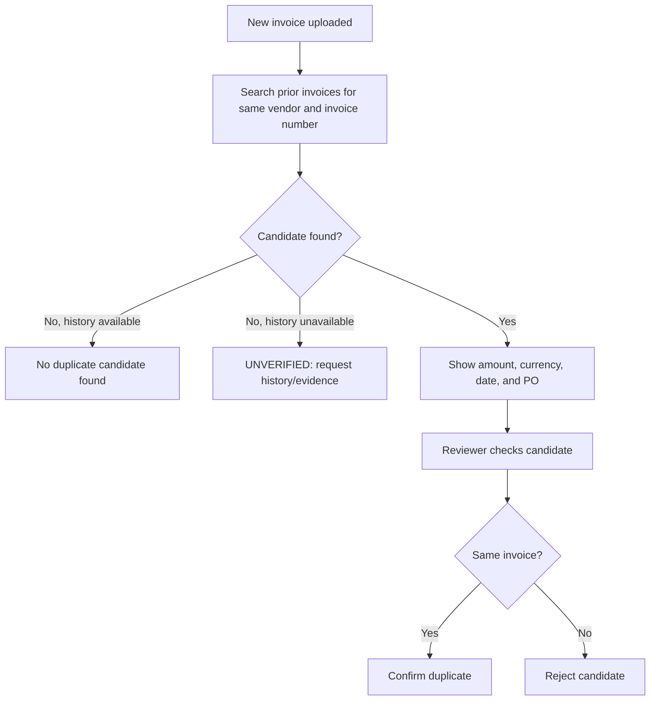

# Duplicate Invoice Detection

**Status:** Draft for product-owner review; unresolved business rules are listed below.
**Authority:** [PRD v1.1](../prd.md), [constitution](../constitution.md), and [draft technical architecture](../technical-architecture.md).

## Purpose and scope

Compare incoming invoices with historical invoice records, distinguishing possible duplicates from confirmed duplicates. Implements FR-04; supports AC-04.

## Inputs

Invoice/vendor identifiers, invoice number, amount, currency, date, PO/supporting references, historical invoices, and source availability. Historical payment records may provide supporting evidence under the agreed policy.

## Behavior

Use the same vendor identifier and invoice number as the initial candidate-matching rule. Exclude the current internal invoice record from matching itself. Preserve separate submissions so they can be compared. Show the candidate's amount, currency, invoice date, and PO alongside the new invoice for human review.

Record possible and confirmed duplicates distinctly. A match on vendor and invoice number is a possible duplicate, not an automatic confirmation. A reviewer checks the supporting details and confirms or rejects the candidate. A confirmed duplicate has the PRD default weight of 40 and forces HIGH when full MVP scoring is implemented.

Unavailable historical records produce UNVERIFIED, not an assertion that no duplicate exists. A verified empty history is different from an inaccessible source.

## Evidence

Record matched internal IDs, compared fields and values, matching rule/version, source availability, duplicate classification, explanation, and evaluation timestamp. Avoid claiming fraud from a duplicate finding alone.

## Acceptance criteria

- Approved confirmed-match fixtures produce the configured weight and HIGH override.
- Approved possible-match fixtures are clearly labeled and are not automatically confirmed.
- A prior invoice with the same vendor and invoice number is surfaced as a possible match with amount, currency, date, and PO details.
- Only a reviewer confirmation changes a possible match to confirmed.
- A record does not match itself.
- Similar invoice numbers from distinct vendors do not automatically establish a duplicate.
- Available nonmatching history produces a complete check; unavailable history produces UNVERIFIED.
- Re-evaluation preserves earlier findings and references to matched records.

## Open decisions

- Exact field combinations, normalization, date windows, and amount tolerances for confirmation.
- Criteria and scoring/hold treatment for possible matches.
- Cancelled invoices, credit notes, corrected submissions, and already-reviewed duplicates.
