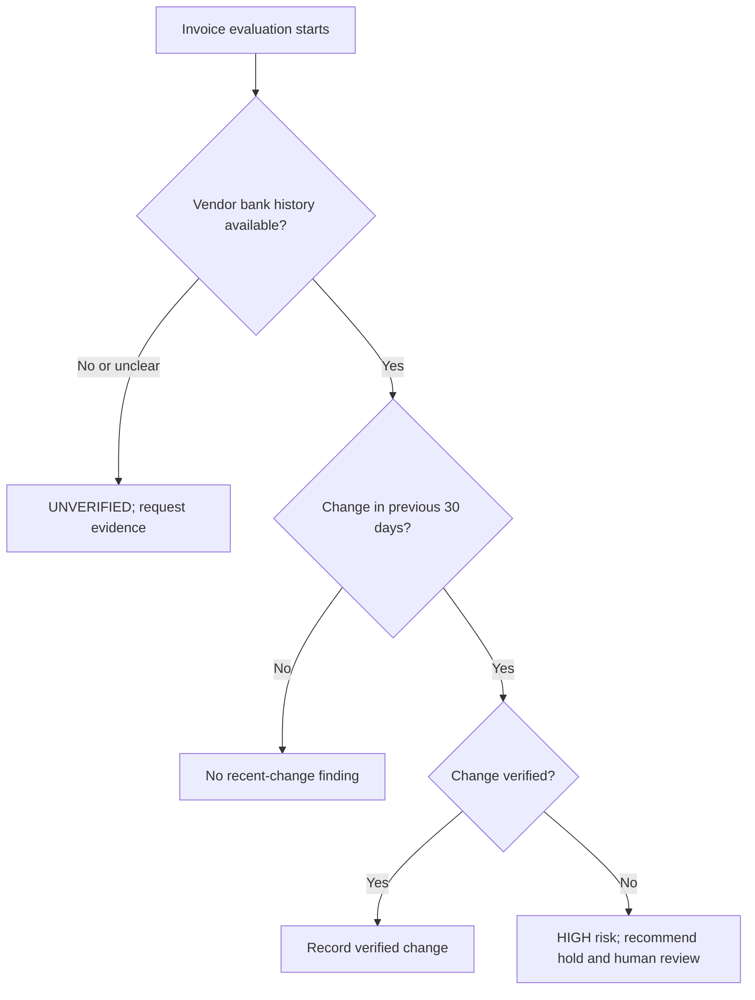

# Vendor Bank-Change Detection

**Status:** Draft for product-owner review; unresolved business rules are listed below.
**Authority:** [PRD v1.1](../prd.md), [constitution](../constitution.md), and [draft technical architecture](../technical-architecture.md).

## Purpose and scope

Identify recent vendor bank-account changes and their verification status. Implements FR-05; supports AC-05.

## Inputs

Vendor reference, bank-history source availability, change timestamps, verification records, masked account identifiers/fingerprints, policy window, and evaluation timestamp.

## Behavior

Evaluate recency against the recorded evaluation timestamp using a rolling 30-day window. A recent unverified change has the PRD default weight of 30, forces HIGH, requires human review, and keeps the case on hold until the reviewer resolves it.

Show the change timestamp and verification status. Unavailable history or inconclusive evidence produces UNVERIFIED and prevents clearance. Do not equate absent history with verified absence of a recent change.

The exact boundary rule for a change exactly 30 days old and the source/standard used to verify a change remain to be specified.

## Evidence and privacy

Record vendor/change references, timestamp, policy version, verification evidence, finding, and evaluation time. Display masked identifiers; exclude full account values from routine findings and logs.

## Acceptance criteria

- A change in the 30 days before evaluation without verification contributes the configured weight, forces HIGH, and requires human review before the case can be resolved.
- A verified recent change is distinguishable from an unverified one.
- Changes outside the window and exact boundary timestamps follow the approved policy.
- Unavailable/inconclusive history produces UNVERIFIED and no clearance recommendation.
- Repeating an evaluation with identical inputs, time, and policy reproduces the result.
- Findings and dashboard output do not unnecessarily expose full account identifiers.

## Open decisions

- Boundary semantics for a change exactly 30 days old and timezone handling.
- Verification evidence/authority and treatment of pending or rejected verification.
- Multiple changes, future timestamps, and scoring treatment for verified recent changes.
