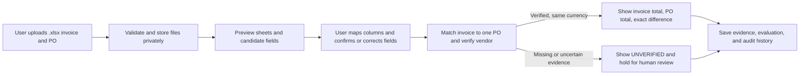

# NAXA — MVP Task Plan

**Status:** Draft implementation plan based on the reviewed MVP documents.
**Purpose:** Break the feature specifications into small, testable implementation tasks.
**Scope:** Deterministic MVP, starting with invoice intake and invoice-to-PO total comparison. No RAG, LangGraph, MCP, payment execution, or authentication in this slice.

## Product flow to build first

## Work order

Complete tasks in order. Each task should be assigned and implemented as a small change, with its acceptance checks run before starting dependent tasks.

### 0. Resolve first-slice implementation prerequisites

These are specification questions, not permission to guess. Record answers in the relevant specification and [decision log](decisions.md) before writing code that depends on them.

- [ ] **TP-001 — Finalize upload processing details.** The initial formats, user flow, parsers, and 10 MB per-file limit are selected: `.xlsx` with `openpyxl`; `.docx` with `python-docx`; preview and map spreadsheet columns to Naxa fields; confirm/correct candidate values. Set visible parser failure/retry behavior before upload implementation.
- [x] **TP-002 — Define how the demo playbook is supplied.** Use a built-in first-slice checklist: invoice and linked PO required; contract optional. Users upload business documents, not a separate playbook workbook. Custom playbook setup and full approval-policy management remain later work.
- [ ] **TP-003 — Resolve remaining data rules needed by the first migration.** Confirm the intended dollar currency code, amount precision/rounding, vendor identity resolution, document-to-record linking, and case/evaluation cardinality. Do not silently turn draft schema assumptions into product decisions.
- [ ] **TP-004 — Set upload safety and demo boundaries.** Define allowed media-type validation, safe filename handling, malware/unsafe-file handling, parser-failure handling, and private-demo access before enabling file uploads. D-023 sets the 10 MB per-file cap.

### 1. Create a runnable local application foundation

- [ ] **TP-101 — Add the backend skeleton.** Create the FastAPI app, configuration from environment variables, health endpoint, and backend test setup.
- [ ] **TP-102 — Add the frontend skeleton.** Create the Next.js/TypeScript app with Tailwind and a minimal upload/review route.
- [ ] **TP-103 — Add local services.** Add Docker Compose for the app dependencies and PostgreSQL, including a private persistent volume for uploaded files and a separate database volume. Keep secrets out of source control.
- [ ] **TP-104 — Add the database foundation.** Configure SQLAlchemy and Alembic, create the first minimal migration after TP-003, and document repeatable migration/startup commands.
- [ ] **TP-105 — Verify the foundation.** Start the services, call the API health endpoint, load the frontend, connect to PostgreSQL, apply migrations, and run a non-empty backend test.

### 2. Implement document intake and confirmation

- [ ] **TP-201 — Implement private file storage behind a storage interface.** Save originals outside PostgreSQL; persist only metadata and opaque storage keys. Prevent the UI from receiving filesystem paths.
- [ ] **TP-202 — Implement validated upload APIs.** Enforce the choices from TP-001/004, use safe generated storage names, store checksum/size/media type, and return clear validation or storage errors.
- [ ] **TP-203 — Record document versions and evidence links.** Keep replaced originals and references; mark the latest version current without overwriting earlier files.
- [ ] **TP-204 — Extract candidate invoice and PO fields.** Use `openpyxl`/`python-docx` for supported content, extract only fields needed by the slice, retain source references, and represent unreadable/uncertain values as unverified. OCR is out of scope.
- [ ] **TP-205 — Build the mapping and confirmation flow.** Preview spreadsheet sheets/columns, let the user map them to Naxa fields, display extracted candidate details, and let the user correct and confirm vendor, invoice/PO number, document total, date when available, and currency before evaluation. Do not require a Naxa workbook template.
- [ ] **TP-206 — Show the playbook checklist.** Indicate required invoice and PO evidence as present, missing, unreadable, or unverified, and tell the user what is needed next.

### 3. Build the first end-to-end invoice-to-PO comparison

- [ ] **TP-301 — Persist the minimum business records.** Add vendors, invoices, purchase orders, document links, compliance cases/evaluations, and check results required by the first slice. Add constraints only after the related rules are settled.
- [ ] **TP-302 — Resolve invoice-to-PO links.** Use the invoice PO number, then verify vendor identity. Support zero or one PO per invoice; keep missing, unmatched, ambiguous, vendor-mismatched, or multiple-PO cases unresolved for human review.
- [ ] **TP-303 — Implement the pure comparison service.** Use Python `Decimal`; compute `invoice total - PO total`; return above/below/equal and evidence references. Do not score this comparison or convert currencies.
- [ ] **TP-304 — Handle incomplete comparisons safely.** Missing/unresolved PO, unconfirmed amount, or missing/unsupported/mismatched currency yields UNVERIFIED with no fabricated difference or clearance recommendation.
- [ ] **TP-305 — Show the comparison result.** Display invoice total, PO total, signed difference, and comparison state. Show earlier invoices as context when available; compare against the full PO total and do not calculate a remaining balance.
- [ ] **TP-306 — Verify the vertical slice.** Add unit tests for positive, negative, and zero differences and invalid/incomplete currency/evidence; API/database integration checks; and a browser-level happy path plus an unresolved-PO path using synthetic data.

### 4. Complete human review and audit behavior

- [ ] **TP-401 — Add review actions.** Support approve, reject, and request clarification with required reason, reviewer identifier, and timestamp. Clarification keeps the case open and on hold.
- [ ] **TP-402 — Add append-only audit events.** Record uploads/replacements, field confirmation, PO linking, evaluation, status change, and reviewer action. Keep prior evaluations and decisions.
- [ ] **TP-403 — Add review dashboard states.** Let a reviewer find open/unverified cases, inspect evidence and comparison, and see their history. No action may initiate or release a payment.
- [ ] **TP-404 — Test review lifecycle.** Verify a clarification request remains on hold, new evidence creates a traceable re-check, and prior evidence/results/actions remain available.

### 5. Add the remaining deterministic risk checks

Implement each rule as an isolated, evidence-producing service with tests before connecting it to the full score.

- [ ] **TP-501 — Contract price comparison.** Keep contracts optional; compare item unit prices only when applicable. Match by item code or request a human selection; do not guess by description.
- [ ] **TP-502 — Duplicate candidate detection.** Find possible matches by vendor and invoice number, show amount/currency/date/PO, and require a human to confirm or dismiss them.
- [ ] **TP-503 — Vendor bank-change check.** Apply the agreed 30-day window and verification state; an unverified recent change is HIGH and on hold. Unavailable history is UNVERIFIED.
- [ ] **TP-504 — Mandatory approval check.** Compare available approval evidence with the playbook requirements. Missing mandatory approval is a critical HIGH condition.
- [ ] **TP-505 — Verify each rule independently.** Add positive, negative, missing-evidence, and boundary tests for each rule and preserve evidence references in results.

### 6. Add risk scoring and finish the MVP dashboard

- [ ] **TP-601 — Finalize scoring policy details.** Confirm mismatch tolerances, rule weights/aggregation, score boundaries, approval-state handling, and any remaining PRD ambiguities before coding the aggregate score.
- [ ] **TP-602 — Implement deterministic scoring and overrides.** Use versioned configuration and decimal-safe inputs. Keep UNVERIFIED separate from LOW/MEDIUM/HIGH; apply critical HIGH overrides regardless of numeric total.
- [ ] **TP-603 — Present results and human actions.** Show known score with UNVERIFIED when some required checks are incomplete; never offer clearance for incomplete evidence. Keep payment decisions human-controlled.
- [ ] **TP-604 — Test scoring boundaries and overrides.** Cover LOW/MEDIUM/HIGH boundaries, critical overrides, incomplete evidence, and repeatability for identical inputs/policy versions.

### 7. Prepare a safe, repeatable demo

- [ ] **TP-701 — Add synthetic demo data and walkthrough.** Provide non-sensitive invoice, PO, contract, approval, duplicate, and bank-change examples with expected results.
- [ ] **TP-702 — Review demo security and file handling.** Confirm private access assumptions, no public file paths, safe errors/logging, no real financial data, and documented storage cleanup/retention behavior.
- [ ] **TP-703 — Run release checks.** Start from documented setup, apply migrations, run backend/frontend checks and end-to-end tests, exercise the demo scenarios, and document any known limitations.

## Completion criteria

The first working milestone is complete when a user can upload an invoice and PO, inspect and confirm extracted totals/currencies/vendor and PO references, resolve or see an unresolved PO link, and view either an exact same-currency difference or an UNVERIFIED review state. The data and source files persist locally, review-relevant actions are traceable, and automated checks cover both success and incomplete-evidence paths.

The **full MVP** is not complete until all five deterministic risk checks, the agreed scoring policy, human review, audit history, and required verification in the feature specifications are implemented and tested.

## Working rules for implementation

- Work from the linked feature specification and this task ID; update the specification if accepted behavior changes.
- Keep financial calculations deterministic with `Decimal`/PostgreSQL `NUMERIC`; AI extraction may suggest values but cannot verify or decide them.
- Write meaningful tests for business behavior and run the checks relevant to each task.
- Use synthetic documents/data in development and demos. Keep original uploads in private file storage, not PostgreSQL or source control.
- Do not add RAG, LangGraph, MCP, authentication, billing, multi-tenancy, or payment execution to the MVP unless a later approved scope change requires them.

## Source documents

- [PRD](prd.md)
- [Project constitution](constitution.md)
- [Technical architecture](technical-architecture.md)
- [Database design](database-design.md)
- [API design](api-design.md)
- [Decision log](decisions.md)
- [Feature specification index](specifications/README.md)
