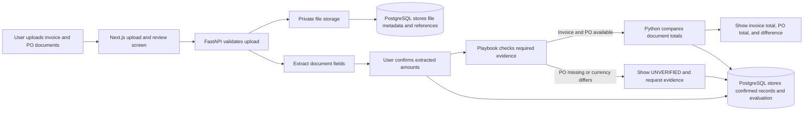
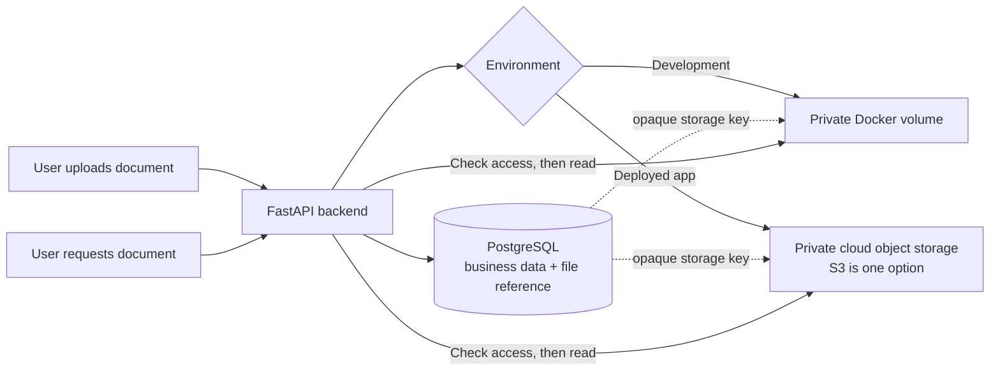

# NAXA — MVP Technical Architecture

**Status:** Draft architecture; detailed technical specification pending.

Phase 1 provides deterministic invoice risk review. RAG, LangGraph, and MCP are deferred to later phases.

## First-slice flow

Users upload the invoice and any available supporting documents directly in the dashboard. Naxa checks the submission against a built-in first-slice checklist and tells the user which required evidence is present, missing, or unverified. The checklist requires the invoice and its linked PO; a contract is optional. Users do not upload a separate playbook workbook.

Original files stay in private file storage. PostgreSQL stores invoice and PO data, confirmed extracted values, playbook/evaluation results, audit events, and an opaque reference to each source file.

Use the same storage interface in each environment: during local development, save files to a private Docker volume; after deployment, configure a private cloud object-storage bucket (AWS S3 is a candidate because AWS is in the later production-engineering plan). The deployed bucket must not be public. The backend reads files using its configured storage credentials and an authorized document ID; the UI does not receive a raw bucket path. Keep the storage provider configurable so changing environments does not change invoice-comparison logic. Cloud provider, access policy, backups, encryption, and retention are deployment decisions to define before launch.

The storage location changes by environment; the application flow remains the same. PostgreSQL stores the file reference and review data, while the original Excel or Word file stays in private file storage.

## Application components

### Frontend — Next.js, TypeScript, Tailwind CSS

Provide direct `.xlsx`/`.docx` upload, spreadsheet sheet/column preview and mapping, candidate-field confirmation, the playbook checklist, comparison results, and the risk-review dashboard. Show missing evidence as a clear request for the document needed.

### Backend — FastAPI and Python

Provide REST APIs for validated `.xlsx`/`.docx` uploads up to 10 MB per file, file metadata, spreadsheet field mappings, confirmed invoice and PO records, playbook checks, comparison results, and review actions. Parse with `openpyxl` and `python-docx`; validate file type/size and record fields. Parser failure handling remains to be specified.

### PostgreSQL and private file storage

Use PostgreSQL for invoices, vendors, purchase orders, contracts, approvals, historical payments, vendor bank-history records, compliance cases, check results, review decisions, audit events, and metadata/references for uploaded documents. Use SQLAlchemy models and Alembic migrations.

Keep original uploaded files in private storage and link them to database records; do not expose storage paths publicly. Local development uses a Docker volume; deployment uses a private object-storage service configured for that environment. PostgreSQL stores the storage key and metadata, not the file bytes. The complete schema should support records and audit history described in the PRD.

### Document extraction and playbook

Extract candidate values from uploaded documents, show them to the user for confirmation, and retain source references. The playbook specifies what evidence is required for a review. Missing, unreadable, or unverified required evidence is surfaced in the dashboard; it cannot be treated as a successful check or clearance.

Use `openpyxl` for `.xlsx` workbooks and `python-docx` for `.docx` text and tables. OCR is out of scope. Custom playbook setup and parser failure behavior remain to be specified; enforce the built-in checklist and 10 MB per-file limit.

### Deterministic risk engine — Python

The engine evaluates the five PRD rules: PO mismatch, contract-price mismatch, duplicate invoice, bank change, and missing approval. It produces recorded findings with supporting evidence and status.

For the first PO comparison slice, compare confirmed invoice and PO document totals using exact decimal arithmetic. Display the signed difference and whether the invoice is above, below, or equal to the PO. Do not score this first slice. Supported currencies are USD, GBP, and PKR; missing, unsupported, or mismatched currency is UNVERIFIED and requires human review. Naxa does not convert currencies. Prior invoices linked to the PO are context only; do not calculate a remaining balance.

### Risk scoring and evidence

Full MVP scoring uses the PRD's LOW, MEDIUM, and HIGH bands, UNVERIFIED review status, and critical overrides. The first PO comparison slice displays the amount difference without scoring. UNVERIFIED is a review status, not a fourth numerical risk band.

| Classification or status | Action |
| --- | --- |
| LOW, with required checks complete | Recommend approval |
| MEDIUM | Manual review |
| HIGH | Hold for review |
| Missing critical evidence: UNVERIFIED | Hold for clarification |

### Human review and audit

Reviewers can approve, reject, or request clarification. Decisions require reasons and recorded reviewer identifiers. Record findings, decisions, evidence references, and timestamps in application-level append-only audit history.

## Technology stack

- Next.js, TypeScript, and Tailwind CSS
- FastAPI and Python
- PostgreSQL, SQLAlchemy, and Alembic
- Pytest
- Docker Compose for local development

Frontend and end-to-end test tooling remains to be finalized; the development guide proposes Playwright.

## Open technical decisions

- Parser failure/retry behavior for `.xlsx` and `.docx`.
- Custom playbook setup and full approval-requirement management/versioning.
- Cloud object-storage provider, access policy, backups, encryption, and retention for deployment.
- File-to-record linking when an uploaded document is ambiguous.
- Database schema, API contracts, and review-state transitions.
- Recent bank-change window; the earlier development guide proposes 30 days, but this is not finalized.

## MVP principle

Keep risk calculations deterministic and payment decisions human-controlled. Add RAG, AI Investigator, LangGraph, and MCP only in later phases when they solve an established product need.
